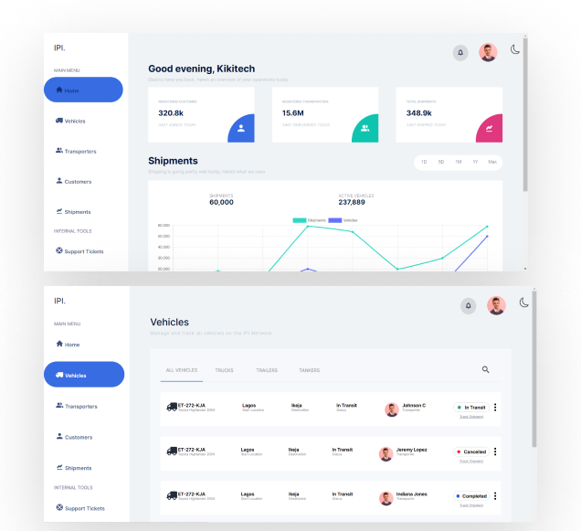

# Kiki Logistics Dashboard

A React frontend concept for a logistics operations workspace, with summary charts, vehicle status cards, and a vehicle tracking modal.

[View the hosted demo](https://logistics-dashboard-black.vercel.app)



*Project preview from the portfolio's existing image assets.*

## Features

- Dashboard overview with example charts and summary metrics.
- Vehicle page with sample transit, cancelled, and completed statuses.
- Vehicle tracking modal with driver, vehicle, and route details.
- Light and dark themes, with the choice saved in local storage.
- Collapsible mobile navigation.

Vehicle data and charts are examples; there is no live tracking service. The search field and category labels do not filter the sample vehicles.

## Stack

React 17, Create React App, React Router 5, Chart.js, styled-components, and Framer Motion.

## Run locally

```bash
git clone https://github.com/okikioriola1/logistics-dashboard.git
cd logistics-dashboard
npm ci
npm start
```

Open the local URL printed by Create React App, usually `http://localhost:3000`. The overview is at `/` and the vehicle screen is at `/vehicles`. No backend or environment variables are required.

This is an older Create React App project. It does not pin a Node.js version; compatibility with current Node/npm releases needs verification before modernizing the toolchain.

## Scripts

| Command | Purpose |
| --- | --- |
| `npm start` | Development server |
| `npm run build` | Production bundle in `build/` |
| `npm test` | Inherited test runner; no test files are currently included |

## Code map

- `src/pages/home/`: dashboard composition.
- `src/pages/vehicles/`: vehicle screen.
- `src/components/charts/`: example charts.
- `src/components/vehicleCard/` and `vehicleModal/`: vehicle presentation and tracking dialog.
- `src/components/styles/`: themes and persistence.

## Next improvements

Connect vehicles and metrics to an API, implement search and category filtering, add keyboard-accessible modal behavior and interaction tests, and update the build tooling with clean-install CI checks.
